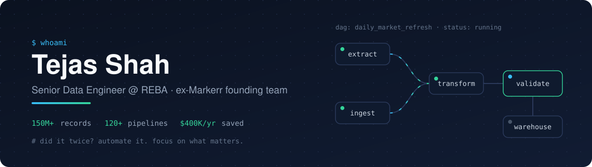

  

  

  
  
  
  
  

---

### Hi, I'm Tejas

Data engineer based in Jersey City. I'm a Senior Data Engineer at REBA (Real Estate Business Analytics). I came over when REBA bought Markerr, where I was on the founding team and built the data platform from the ground up. These days I lead products end to end, from the first conversation with product to keeping things running in prod. The platform has 150M+ property records across 400+ US markets.

Right now I'm:
- leading data products end to end
- making architecture calls and doing code reviews
- mentoring engineers on Spark and Airflow
- doing an AI agents bootcamp and building small things on the side

### Some numbers

- 120+ production ETL pipelines (Python, dbt, Airflow, Spark)
- ~$400K/year saved on GCP by fixing expensive queries and reworking partitioning and storage
- 5+ product launches led end to end
- 70% of hedge fund report delivery automated at 7Park Data

### Tools I use

**Pipelines** 

**Cloud** 

**Languages and analysis** 

**Other** 

### Where I've worked

- **REBA** (2026 - now): Senior Data Engineer, after REBA acquired Markerr
- **Markerr** (2021 - 2026): Senior Data Engineer, founding team
- **7Park Data** (2020 - 2021): Data Engineer. Pipelines on Databricks, mentored engineers, led a 6 person offshore team. 7Park was acquired by Vista.
- **7Park Data** (2017 - 2019): Software Engineer. Ran all customer report delivery by myself for about 2 years, plus Django/Flask services and data QA.

MS in Computer Science from University at Albany (SUNY), BTech in CS from Ganpat University.

### My one rule

If I'm doing something more than once, I automate it and spend the time on what actually matters.

---

  
  

  

  <picture>
    <source media="(prefers-color-scheme: dark)" srcset="https://raw.githubusercontent.com/Tejas274/Tejas274/output/snake-dark.svg" />
    <source media="(prefers-color-scheme: light)" srcset="https://raw.githubusercontent.com/Tejas274/Tejas274/output/snake-light.svg" />
    
  </picture>

Happy to chat about data platforms, Airflow, or cutting cloud costs. Reach out on LinkedIn.

